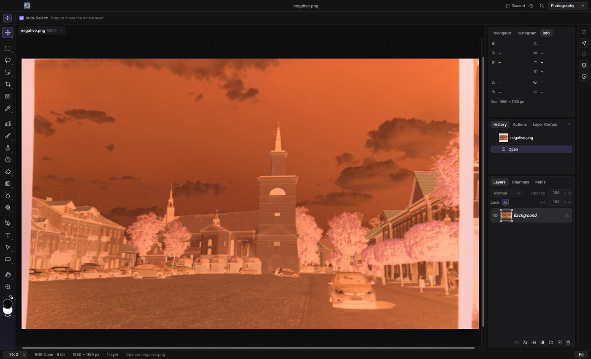
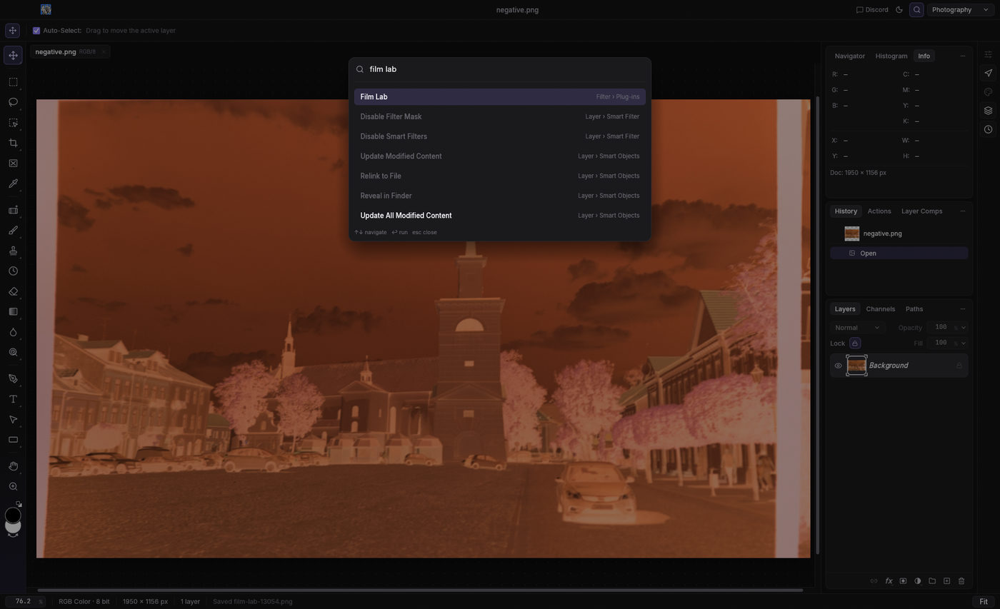
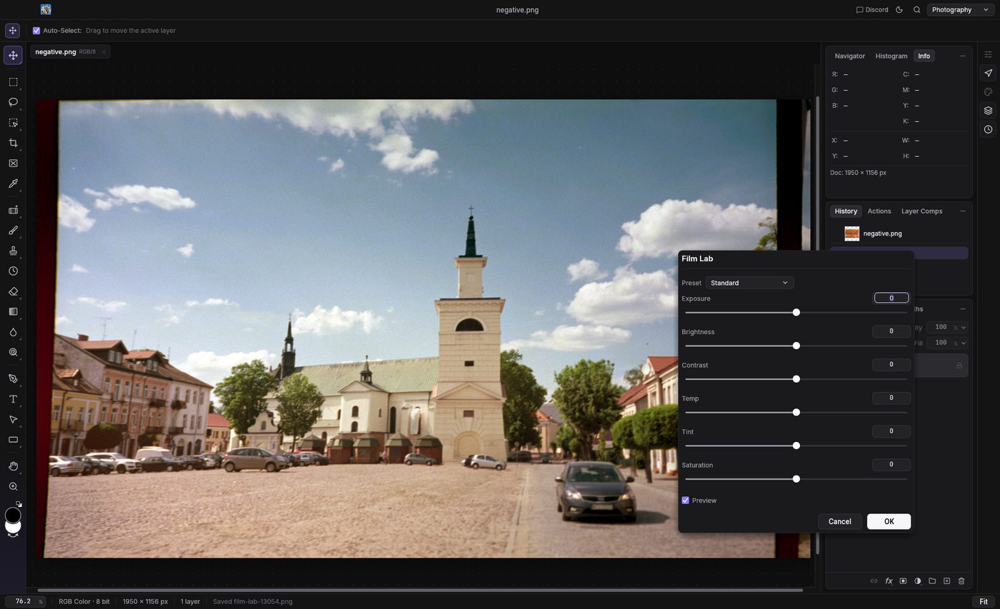
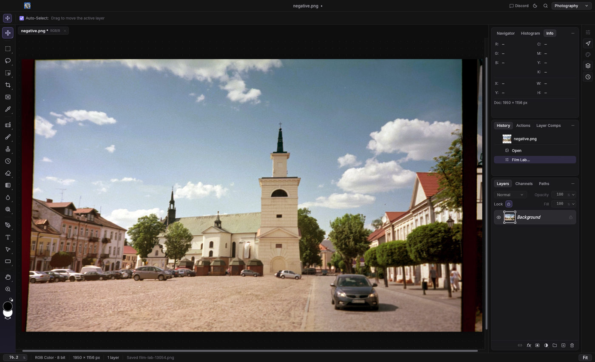
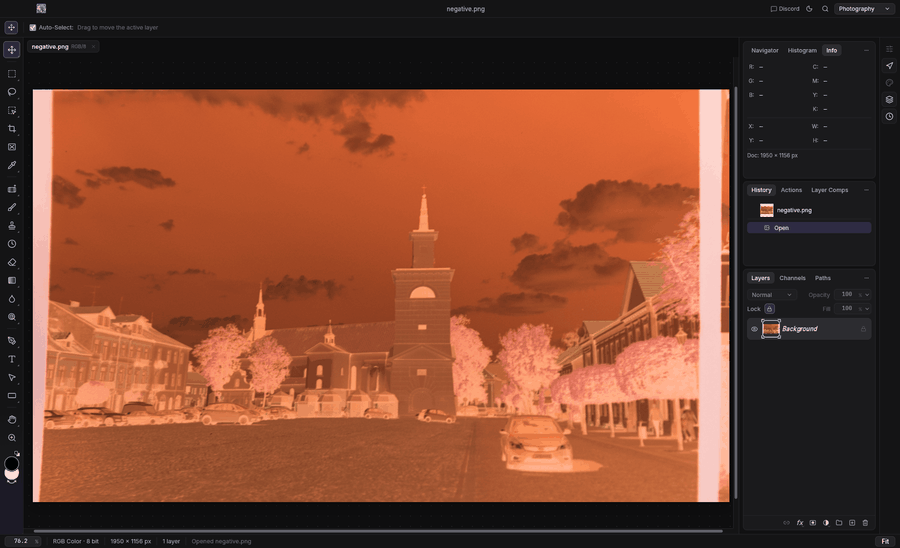

<h1 align="center">Film Lab</h1>

<p align="center"><b>A film lab inside your photo editor.</b></p>

<p align="center">A suite of plug-ins for negative and analog photography in the <a href="https://getartcraft.com/apps">Crafting Apps</a>, in pure Rust. Today: film-negative conversion in <a href="https://github.com/storytold/photocraft">PhotoCraft</a>.</p>

<p align="center">
  
  
  
  
  
</p>

> [!NOTE]
> **Under development.** Negative conversion, the first part of the suite, works end to end in
> PhotoCraft, with its companion and film presets. The presets are starting points that may
> need further calibration (see [Presets](#presets)), and LightCraft support waits on a plug-in
> API.

## Screenshots

<table>
  <tr>
    <td width="50%" valign="top">
      
      <p><sub>The scan open in PhotoCraft: a frame of Kodak Ektar 100.</sub></p>
    </td>
    <td width="50%" valign="top">
      
      <p><sub>Once installed, the plug-ins sit under Filter › Plug-ins; ⌘F finds them by name.</sub></p>
    </td>
  </tr>
  <tr>
    <td width="50%" valign="top">
      
      <p><sub>Convert Negative: a film preset and six sliders, with a live preview. The measurement is never shown.</sub></p>
    </td>
    <td width="50%" valign="top">
      
      <p><sub>The positive, as one history step.</sub></p>
    </td>
  </tr>
</table>

Every screenshot is the real application, driven over its control channel by
`scripts/screenshots.sh`, converting an openly licensed Ektar 100 negative
([attribution](docs/images/ATTRIBUTION.md)). The GIF under
[Use in PhotoCraft](#use-in-photocraft) shows the same flow in motion.

## What it does

Film Lab is a suite of plug-ins for negative and analog photography, each a menu entry in the
host app, sharing one core of film maths. The first part of the suite converts a scanned colour
or black-and-white negative on the active layer into a positive, as two plug-ins:

- **Convert Negative**: a **film preset** and six sliders (exposure, brightness, contrast,
  temperature, tint, saturation). Pick the film, adjust, OK.
- **Convert Negative (Advanced)**: the same, plus the film base typed in from the border, the tone
  curve, highlights and shadows, white balance, a gray point, the colour look and sharpening.

What belongs to the scan rather than the film, the film base and each channel's black and white
point, is measured on the whole image by the companion, because a plug-in only ever sees one band
of the layer. The companion also converts whole rolls without the app. The conversion itself is
built from the physics of colour negatives and the film makers' published data.

| Part | Role | Code |
|---|---|---|
| **Plug-ins** | Convert the layer inside PhotoCraft, with a live preview, as one history step | [`crates/photocraft`](crates/photocraft) |
| **Companion** (`film-lab`) | Measures the whole scan, installs a plug-in with the measurement inside and applies it; converts single scans and rolls through `photocraft-cli` | [`crates/companion`](crates/companion) |
| **Presets** | Ten film stocks, from Kodak Portra to CineStill 800T, plus a neutral default and monochrome | [`crates/core/src/preset.rs`](crates/core/src/preset.rs) |
| **Core** | The conversion: levels in density space, colour, tone and toning; `no_std`, no allocator, host-agnostic | [`crates/core`](crates/core) |

## Hosts

| App | Plug-in API | Status |
|---|---|---|
| **PhotoCraft** | Sandboxed WebAssembly filter plug-ins (ABI v1): a `.wasm` module with no imports, run by wasmi on bands of the layer, installed with `plugin.install` or from the plug-ins folder, listed under Filter › Plug-ins. | Supported: `crates/photocraft`, one module per plug-in (a module is one menu entry), with `crates/photocraft-harness` driving the ABI in tests. |
| **LightCraft** | None yet; the app offers a control protocol, an MCP server and a CLI. | Planned: a `crates/lightcraft` adapter over the same core once a plug-in API ships. |

## Use in PhotoCraft



Once installed, the plug-ins appear as **Filter › Plug-ins › Film Lab: Convert Negative…** and
**Film Lab: Convert Negative (Advanced)…**.

The conversion needs the scan's film base and each channel's black and white point. PhotoCraft
hands a plug-in the layer in strips, with no whole-image pass, so the measuring is done by the
companion: it reads the open document, measures it as a whole, installs the plug-in with the
measurement written inside the module, and applies it. A plug-in opened from the menu on a scan
that has not been measured falls back to the preset's typical film base, or, in the advanced
dialog, to the one you type in (see [Without the companion](#without-the-companion)).

`film-lab` is the companion binary; `cargo build --release -p film-lab-companion` puts it in
`target/release/film-lab`. It installs Convert Negative, or Convert Negative (Advanced) with
`--advanced`, from the repository's build (`crates/photocraft/build.sh`), from `--plugin PATH`
or from `$FILM_LAB_WASM`.

**1. Start PhotoCraft with its control channel and open the scan.** The companion talks to the
app through that channel; the two folders are where the app may read and write files on its
behalf. Any RGB or greyscale document works, at 8, 16 or 32 bits.

```sh
photocraft --control 7878 --control-token-file ~/photocraft.token \
  --automation-read-root ~/scans --automation-write-root ~/scans
```

**2. Apply the plug-in with the companion.** One command, nothing to type into the app: it
saves a flattened copy of the document through the channel, measures it, installs the plug-in
with the measurement inside and runs it.

```sh
film-lab app --root ~/scans --token-file ~/photocraft.token --preset portra400
```

The document converts in place as one history step. With `--dialog` the plug-in's dialog opens
instead, with the measurement already in place, to choose the preset and adjust the sliders
against the live preview before OK:

```sh
film-lab app --dialog --root ~/scans --token-file ~/photocraft.token
```

The options of `film-lab analyze` apply here too: `--border 8` leaves the outer 8 % of the scan
out of the measurement, and `--wb neutral` balances the channel medians. `--advanced` does the
same with the advanced plug-in.

**3. Or open the dialog from the menu.** Once the companion has installed a plug-in, its menu
entry (or ⌘F and its name) opens the same dialog, carrying the measurement of the scan last
measured. This is the way to try another preset or setting on that scan; for a new scan, run the
companion again. The measurement is never shown in the dialog: it travels inside the module.

**4. OK.** The positive replaces the layer's pixels as one history step, named after the
plug-in, so it undoes in one go; on a Smart Object it is a smart filter. Everything is computed
from the scan each time, so re-running with another preset is the way to edit.

The GIF and the screenshots convert one frame of a Kodak Ektar 100 strip that
[LoMit photographed against daylight](https://commons.wikimedia.org/wiki/File:Color_print_film_strip_01_-_negative.jpg)
(CC BY 4.0, cropped; see [docs/images/ATTRIBUTION.md](docs/images/ATTRIBUTION.md)).
`scripts/fetch-samples.sh` downloads it, the photographer's own positive and a CC0 scan of a
110 frame into `corpus/`; `scripts/screenshots.sh` regenerates every image and the GIF.

### Picking the film base

The advanced dialog takes the film base as three numbers, **Film Base Red**, **Green** and
**Blue**, on the Info panel's 0–255 scale: sample the unexposed border (between frames, or along
the film edge) with the Eyedropper and type in what the Info panel shows, or read the same values
from the file with `film-lab sample scan.tif X Y`. PhotoCraft's plug-in dialogs have numbers,
checkboxes and menus but no colour picker, hence three fields.

- **All three at 0** (the default): the base is the companion's measurement, or the preset's
  typical mask colour when the module holds none.
- **Set**: the typed base wins over both. With a measurement in the module, its white point and
  balance still apply.

**Gray Point Red / Green / Blue** work the same way, for a scan colour that should come out grey.
Left at its defaults, the advanced plug-in converts exactly as Convert Negative does.

## Presets

Pick the stock the roll was, or the one it should have been.

| Preset | Film | Character |
|---|---|---|
| Standard | a neutral lab scan | even layer contrast, neutral colour, the lab tone profile |
| Portra 160 | Kodak Portra 160 | the gentlest Portra: low contrast, pastel saturation, warm natural skin, soft warm highlights |
| Portra 400 | Kodak Portra 400 | the portrait standard: moderate contrast, warm skin, muted but full colour, warm highlights, cool shadows |
| Ektar 100 | Kodak Ektar 100 | the saturated one: steep layers, vivid reds and blues, clean neutrals, contrast to match |
| Gold 200 | Kodak Gold 200 | golden: warm yellow highlights, warm neutrals, saturated reds and yellows |
| ColorPlus 200 | Kodak ColorPlus 200 | the everyday stock: warm like Gold but softer, warm shadows, slightly faded |
| UltraMax 400 | Kodak UltraMax 400 | punchy: saturated, contrasty, warm, strong blues |
| Superia 400 | Fujifilm Superia X-TRA 400 | Fuji's greens: cooler than Kodak, vivid, teal shadows, a touch of magenta in skin |
| C200 | Fujifilm C200 | clean and cool: soft contrast, restrained saturation, a green-cyan lean in the shadows |
| Pro 400H | Fujifilm Pro 400H | pastel: flat layers, airy highlights, mint greens, cyan shadows, soft skin |
| CineStill 800 | CineStill 800T | tungsten cine stock in daylight: low contrast, muted colour, teal shadows against warm highlights |
| Monochrome | black-and-white stocks | a paper-like straight line with some contrast, no colour |

The dialogs list the presets as written here; on the command line any spelling works
(`portra400`, `Portra 400`). The film names are trademarks of their makers (Eastman Kodak,
FUJIFILM, CineStill) and identify the stock a recipe takes after. The recipes are this project's
own; nothing here is endorsed by or affiliated with those companies.

> [!NOTE]
> The presets may need further calibration. They are built from the stocks' published
> characteristics and the way they are known to render, not measured from the films, and only
> Portra 400 has been checked against a lab scan so far. How a stock renders also depends on
> the scanner, the exposure and the lab, so treat each preset as a starting point and tune it
> against your own reference scans. Corrections, with a scan and a trusted positive of the
> same frame, are welcome.

A preset is a small table in `crates/core/src/preset.rs`: the density per log-exposure of each
layer, the typical mask colour, a tone profile, a colour model, and saturation, warmth and
toning offsets.

## Without the companion

- **No measurement.** Without the companion's measurement in the module, the preset's typical
  mask colour stands in for the film base (or the base typed into the advanced dialog), with a
  fixed range. The result is identical on every strip, so seam-free at any size, and right when
  the scanning setup matches the preset.
- **Never per strip.** The plug-ins never measure the pixels they are given: PhotoCraft hands
  them the layer in strips of 256 rows, each in a fresh sandbox, the preview included, so a
  per-strip measurement would give every strip its own levels and show as blocks.
- **Installing by hand.** Take the `.wasm` files from a release, or build them with
  `crates/photocraft/build.sh`. Install one with `plugin.install {"path": …}` over the control
  channel, or copy it into the folder set in Edit › Preferences › Plug-ins.

## Headless

The companion runs the same measurement and the plug-in through `photocraft-cli`, for one scan
or for a roll with one shared measurement:

```sh
cargo run -p film-lab-companion -- convert scan.tif -o positive.tif --preset portra400
cargo run -p film-lab-companion -- convert roll/ -o out/ --master roll/frame07.tif
```

`film-lab analyze` prints the measurement, `sample` reads a scan colour as the Info panel shows
it, and `compare` measures a result against a reference positive. The advanced plug-in on its
own, with no measurement and the border's colour typed in:

```sh
crates/photocraft/build.sh
photocraft-cli run scan.tif \
  --cmd plugin.install --params '{"path": "/abs/path/film_lab_convert_advanced.wasm"}' \
  --cmd plugin.run --params '{"id": "io.github.smyrgeorge.film-lab.convert-advanced", "params": {"preset": "Portra 400", "filmBaseRed": 205, "filmBaseGreen": 162, "filmBaseBlue": 110}}' \
  --out positive.tif
```

Measured with `film-lab compare`: on a lab-scanned Portra 400 frame, the companion's analysis
with an 8 % border buffer lands every channel's mean within about 1 % of the lab's positive; on
the Ektar 100 frame above, against the photographer's own positive, `--wb neutral` lands within
about 4 %.

Both plug-ins' parameters, the measurement block and the conversion are described in
[`crates/photocraft/README.md`](crates/photocraft/README.md), and the companion in
[`crates/companion/README.md`](crates/companion/README.md). To try a plug-in without a scan,
`cargo run -p film-lab-photocraft-harness --example synthetic_negative -- DIR` writes a
synthetic negative together with the scene it came from.

## Layout

```text
Cargo.toml                     workspace: crates/* minus crates/photocraft
crates/
  core/                        film-lab-core: the conversion (no_std, no allocator, host-agnostic)
  photocraft/                  the wasm plug-ins, their own workspace (like PhotoCraft's example plug-in)
    abi/                       film-lab-photocraft: the ABI v1 exports, the band, the measurement block
    convert/                   film_lab_convert.wasm: Film Lab: Convert Negative
    advanced/                  film_lab_convert_advanced.wasm: Film Lab: Convert Negative (Advanced)
  photocraft-harness/          host-side checks for the plug-ins (wasmi, fuel-metered like PhotoCraft)
  companion/                   film-lab: whole-image analysis and roll conversion through photocraft-cli
scripts/
  fetch-samples.sh             the openly licensed sample negatives
  manual-test.sh               PhotoCraft with the plug-ins installed and a scan open
  screenshots.sh               the README's images and GIF
  release.sh                   bump the version, commit, tag and push: a release
.github/workflows/
  ci.yml                       fmt, clippy, tests, plug-in build
  release.yml                  on a tag vX.Y.Z: the CI checks, then a GitHub release with the plug-ins
```

`core` knows nothing about a host, its pixel layout or how parameters arrive; each host crate
adapts its app's ABI to the core. A LightCraft crate would be another such adapter.

## Build and test

```sh
rustup target add wasm32-unknown-unknown   # once

cargo test --workspace                     # core, plug-in harness (builds the plug-ins), companion
cargo clippy --workspace --all-targets -- -D warnings
crates/photocraft/build.sh                 # → crates/photocraft/target/wasm32-unknown-unknown/release/
```

`scripts/manual-test.sh` builds the plug-ins and starts PhotoCraft on its control channel with
both installed and the sample negative open, then stays attached until the app quits:

```sh
scripts/manual-test.sh                       # Filter › Plug-ins › Film Lab: … on the sample frame
scripts/manual-test.sh --plain               # the bare modules, with no measurement inside
scripts/manual-test.sh --negative my-scan.tif --photocraft /path/to/photocraft
```

The plug-ins go in with the companion's measurement of the negative, so their menu entries
convert as the companion does; `--plain` installs the bare modules instead. While the script
runs, the companion reaches the same instance with
`film-lab app --dialog --root target/manual --token-file target/manual/token`.

## Release

The plug-ins share one version, in `crates/photocraft/Cargo.toml` (`[workspace.package]`), and
their manifests report it to PhotoCraft; the core and the companion follow it in `Cargo.toml`.
`scripts/release.sh` bumps both, runs the CI checks, commits "Release X.Y.Z", tags `vX.Y.Z` and,
once you confirm, pushes `main` and the tag together:

```sh
scripts/release.sh              # minor: 0.1.0 → 0.2.0
scripts/release.sh patch        # or major, or an exact version such as 0.2.0-rc.1
scripts/release.sh 0.1.0        # the current version: only the tag (the first release)
```

It refuses a dirty tree, a branch other than `main`, a `main` behind `origin`, or a tag that
already exists; `--yes` skips the question and `--no-checks` the checks.

`.github/workflows/release.yml` runs the CI checks, refuses a tag that differs from that
version, builds the modules with `--locked`, and publishes a GitHub release with
`film_lab_convert.wasm`, `film_lab_convert_advanced.wasm` and their `SHA256SUMS`. A version
with a suffix (`0.2.0-rc.1`) is a pre-release. Run the workflow by hand (Actions › release › Run
workflow) to get the modules as a build artifact without releasing anything.

## Design notes

- **PhotoCraft runs each band in a fresh instance with no whole-image pass**, so the companion
  measures the whole scan and the measurement reaches every band the same way: inside the
  module. The host drops parameters a manifest does not declare, so the numbers cannot travel
  as hidden parameters; the companion writes them into a reserved block of the plug-in before
  installing it.
- **A module is one menu entry, and PhotoCraft draws one flat dialog from its manifest**, with
  no sections or hiding. So the everyday dialog stays a preset and six sliders, with the film's
  character in the preset tables, and the full set of controls is a second plug-in built from the
  same code.
- **PhotoCraft labels a control from its key and a menu option from its text**, so the keys are
  camelCase (`filmBaseRed` reads Film Base Red) and the options are written for people; the
  harness checks every label against the host's rule.
- **The host meters instructions per sample and interprets the module**, so the per-channel
  transfer functions are sampled into lookup tables once per band and interpolated per pixel,
  with no transcendental call per sample. The harness pins the budget, the core's tests the
  accuracy.
- **Plug-ins see the document's own colour model** (RGB, grey, Lab, CMYK…) as normalised `f32`,
  with no colour management; the plug-ins refuse CMYK and multichannel documents.
- **Conventions** follow the Crafting Apps: pure Rust, no panics in non-test code
  (`unwrap`, `expect` and `panic` are denied in every production crate), and no `unsafe` outside
  the plug-ins' ABI surface.

## References

- PhotoCraft: `docs/plugins.md` (ABI v1), `examples/plugins/invert-rs`, `crates/plugins` (limits,
  manifest validation, band splitting), `crates/ui-egui/src/filter_dialog.rs` (how a plug-in's
  dialog is drawn and labelled)
- LightCraft: `docs/gaps.md`, `docs/target-app-parity.md` (plug-in ecosystem status)

## License

[MIT](LICENSE). The film names in the presets are trademarks of their makers (see
[Presets](#presets)); the sample photographs in the screenshots have their own licences (see
[docs/images/ATTRIBUTION.md](docs/images/ATTRIBUTION.md)).
